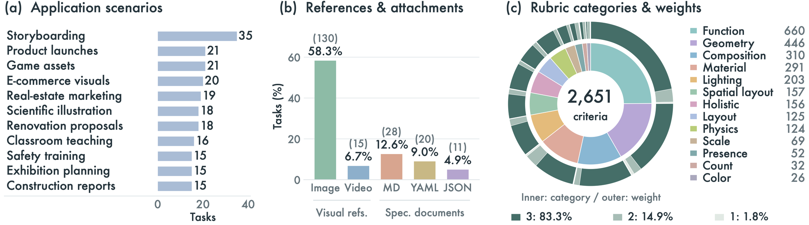
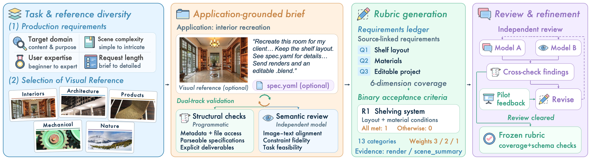
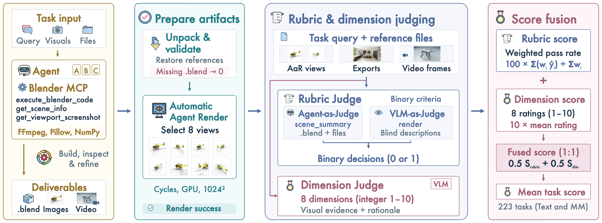

<p align="center">
  
</p>

<h1 align="center">BlenderWorld</h1>

<p align="center"><strong>Benchmarking Visual Agents for 3D Creation from Real-World References</strong></p>

<p align="center">
  <a href="https://huggingface.co/datasets/Qwen/BlenderWorld">Dataset</a> ·
  <a href="#quickstart">Quickstart</a> ·
  <a href="#evaluation">Evaluation</a> ·
  <a href="#documentation">Documentation</a>
</p>

[](docs/assets/benchmark-overview.jpg)

*From real-world references to editable 3D scenes. The benchmark contains 223 tasks across 9 categories and 22 subcategories; references appear on the left/top and GPT-6-Astra outputs on the right/bottom.*

BlenderWorld evaluates agents on realistic 3D creation requests in Blender. Agents receive a task brief, reference media when applicable, and any declared specification files, then deliver an editable Blender project and the requested exports. Run your model with any generation harness, collect one submission ZIP per task, and evaluate it with `bw evaluate`. [Harbor integration](docs/harbor.md) is available as an optional generation and verification adapter.

## Dataset

BlenderWorld contains **223 tasks and 2,651 binary criteria**, spanning products, architecture, environments, characters, animation, and scientific visualization. All tasks use neutral IDs from `bw_0001` to `bw_0223`.

| Input | Tasks |
| --- | ---: |
| Text | 78 |
| Image + text | 130 |
| Video + text | 15 |
| Total | 223 |

**59 tasks** also include specification attachments with requirements on dimensions, materials, or camera settings. These files can accompany visual references.

[](docs/assets/dataset-statistics.png)

*Dataset statistics. (a) shows the 11 largest application scenarios, covering 213 of 223 tasks; (b) reference and specification types may co-occur; (c) the inner ring shows category and the outer ring shows importance.*

<details>
<summary><strong>How the benchmark is built</strong></summary>

<br />

[](docs/assets/benchmark-construction.png)

*From production briefs to verifiable requirements. Diverse tasks and references undergo structural and semantic validation, followed by independent rubric review.*

</details>

## Quickstart

### 1. Install and download

Use Python 3.10+ on Linux. Download the dataset and check every task and resource:

```bash
git clone https://github.com/QwenLM/BlenderWorld.git
cd BlenderWorld
python -m pip install -e .
bw download --output data/BlenderWorld
bw verify data/BlenderWorld
bw list data/BlenderWorld --modality image
```

To use an existing local dataset, pass its directory to `--dataset`. To pin a published revision, pass its commit SHA to `bw download --revision`.

### 2. Prepare, generate, and package

Prepare the inputs for one generation agent:

```bash
bw prepare --dataset data/BlenderWorld --task-id bw_0001 --output work/bw_0001
```

The prepared workspace contains `query.txt`, `input.json`, reference media, and declared attachments. Give the agent access to this workspace and Blender through its normal coding or MCP tools. Save the primary project as `model-output/final.blend`, alongside its requested exports and texture dependencies. Keep inputs and evaluation rubrics outside this output directory. Package its contents as one ZIP for the task:

```bash
bw pack-submission --source model-output --task-id bw_0001 \
  --output submissions/bw_0001.zip
```

The ZIP contains `final.blend` at its root, with optional `textures/` and `outputs/` folders. Ordinary ZIP tools are supported too. See [the complete public submission format](docs/submissions.md).

Generate projects with **Blender 4.2.10**. When using the bundled coding-agent environment, the other pins are **Node.js 22.17.0, Codex CLI 0.147.0, and Claude Code 2.1.220**.

### 3. Evaluate

Evaluation needs Blender 4.2.10, Node.js 22.17.0, ffmpeg/ffprobe, and the configured Claude Code 2.1.220 CLI for rendering and scene inspection, plus a vision-capable Chat Completions endpoint. Configure the endpoint and key variables described in [the evaluation guide](docs/evaluation.md) in your shell. Model aliases must exist at their configured endpoints; the paper uses GPT-5.6-terra for all three evaluator roles.

```bash
bw evaluate --dataset data/BlenderWorld --submissions submissions \
  --task-id bw_0001 --output runs/one-task --dry-run
bw evaluate --dataset data/BlenderWorld --submissions submissions \
  --task-id bw_0001 --output runs/one-task --resume
```

Omit `--task-id` for all 223 tasks. Missing or failed submissions receive zero and remain in the selected denominator. `--dry-run` writes a plan without invoking Blender or model services. JSON and CSV results are written to the run directory.

## Evaluation

[](docs/assets/evaluation-pipeline.png)

*The paper pipeline combines 8 adaptive views and scene inspection with a weighted binary rubric and 8 visual-quality ratings, weighted 50:50. The figure shows the paper setup (Cycles, GPU, and Blender MCP); the public evaluator also supports CPU Cycles and accepts submissions from any generation harness.*

The renderer selects **eight adaptive views**, using Cycles at **1024 × 1024 and 64 samples**. It preserves the submitted scene and allows up to **two corrective re-renders per view**. Original authored images and sampled animation frames provide additional evidence.

Scene-inspection criteria are assigned to Agent-as-Judge; visual criteria and eight holistic quality dimensions are assigned to the VLM. Each binary criterion has importance weight 1, 2, or 3.

```text
Rubric score    = 100 × Σ(weight × pass) / Σ(weight)
Dimension score = 10 × mean(eight ratings from 1 to 10)
Final score     = 0.5 × rubric score + 0.5 × dimension score
```

The public protocol applies no score cap. It requires fresh evaluator renders, complete structural verdicts, and all eight dimension ratings. See [the protocol and runtime guide](docs/evaluation.md) for configuration, evidence, and resuming runs.

## Documentation

Read the [dataset format](docs/dataset.md) for task records and resources, the [submission ZIP format](docs/submissions.md) before packaging results, and the [evaluation protocol](docs/evaluation.md) for runtime configuration, evidence, and resuming runs. [Harbor integration](docs/harbor.md) describes the optional generation and verification adapter.
